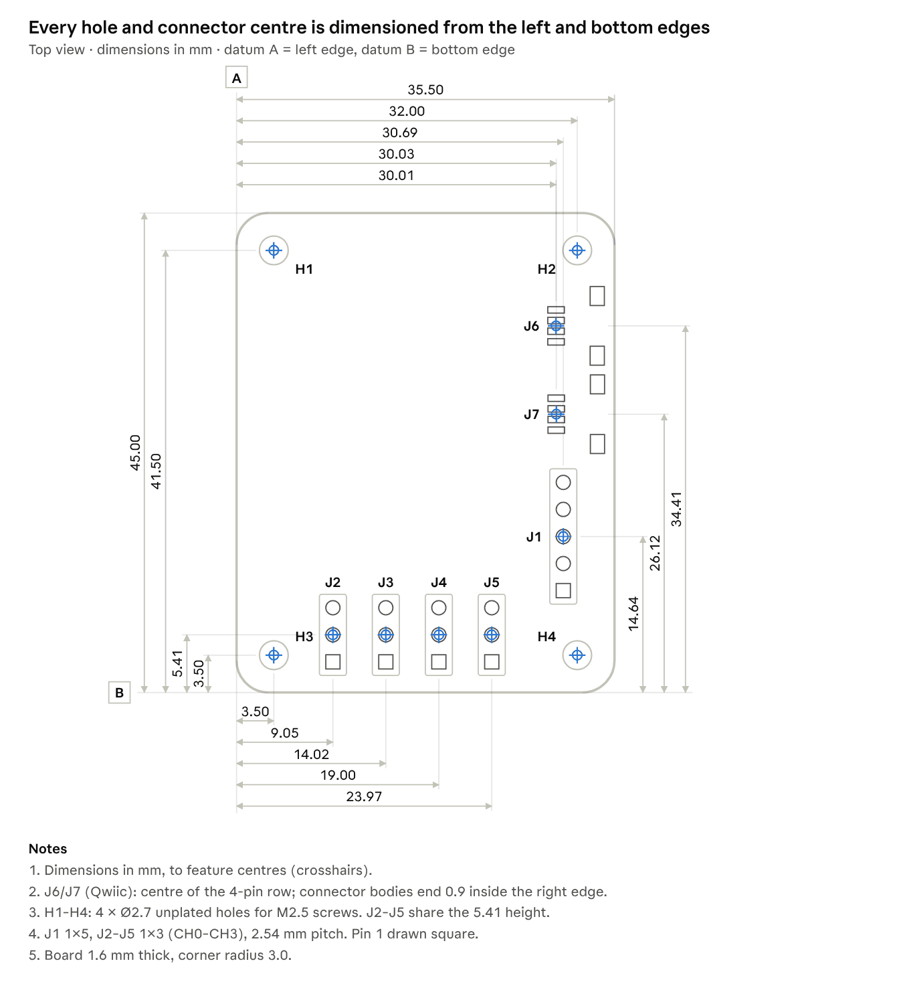

# Board layout and pinouts

The host connects to J1. Each sensor has its own 3-pin header, J2–J5. Every header has GND on pin 1 and VDD on pin 2.

**Minimum wiring:** 4 wires from the host to J1 (GND, VDD, SCL, SDA), and 2 or 3 wires per sensor to its header.

## J1 — host header (1×5, 2.54 mm)

| Pin | Signal | Connect to |
|---|---|---|
| 1 | GND **(Required)** | Host ground |
| 2 | VDD **(Required)** | The host's 3.3 V pin. See [Which host pin to use](specifications.md#which-host-pin-to-use) |
| 3 | SCL **(Required)** | Host I²C clock |
| 4 | SDA **(Required)** | Host I²C data |
| 5 | RDY (Optional) | A GPIO input, for conversion-ready or threshold alerts. The board pulls it up to VDD |

!!! danger "Never power the board from 5 V when it is wired to a Raspberry Pi or ESP32"
    The I²C pull-ups connect to VDD, so SDA, SCL and RDY then carry 5 V into the host's 3.3 V pins and can damage the host.

!!! danger "Never swap VDD and GND"
    The board has no reverse-polarity protection. Check pins 1 and 2 before you switch on.

## J2–J5 — sensor headers (1×3, 2.54 mm, one per channel)

| Header | Channel | Pin 1 | Pin 2 | Pin 3 |
|---|---|---|---|---|
| J2 | CH0 (A0) | GND | VDD | SIG |
| J3 | CH1 (A1) | GND | VDD | SIG |
| J4 | CH2 (A2) | GND | VDD | SIG |
| J5 | CH3 (A3) | GND | VDD | SIG |

SIG and GND are required for every sensor. VDD is optional: Use it only for a sensor that the board powers.

!!! danger "VDD on the sensor headers is a supply output: Never connect a supply to it"
    It carries the board's own supply from J1, to power the sensor. A 5 V sensor's supply goes to your 5 V source, and only its GND and SIG go to the header. Keep the total load across all four headers to 500 mA or less, and within your host's 3.3 V rating. That suits sensor modules, but not motors, relays or gas-sensor heaters. The sensor supply has no fuse: A short between a header's VDD and GND pulls down the host's 3.3 V supply and resets the host.

## Solder jumpers

| Jumper | Default | Function |
|---|---|---|
| JP1 | Closed (trace) | I²C address 0x48 (ADDR to GND through a 10 kΩ resistor, R13) |
| JP2 | Open | I²C address 0x49 (ADDR to VDD) |
| JP3 | Open | I²C address 0x4A (ADDR to SDA) |
| JP4 | Open | I²C address 0x4B (ADDR to SCL) |
| JP5–JP8 (RES) | Open | Close to enable the 10 kΩ excitation resistor on CH0–CH3, for resistive sensors |

## Test pads and other parts

**Test pads (1.5 mm)**: TP1–TP4 on the ADC side of each input (AIN0–AIN3), TP5 VDD, TP6 GND, TP7 SDA, TP8 SCL, TP9 RDY.

**Mounting holes**: H1–H4, M2.5 (2.7 mm), unplated and not connected.

**No power LED**: This keeps the idle current to 5 µA. To check the board is powered, measure from TP5 to TP6 or run an I²C scan.

## Dimensions

*Top view. All dimensions in mm, from the left edge (datum A) and bottom edge (datum B) to feature centres.*
